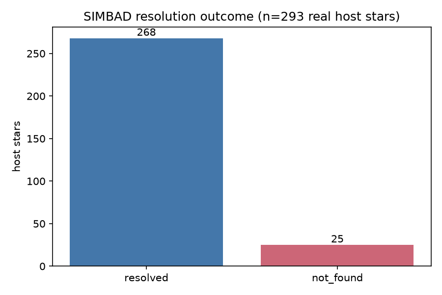
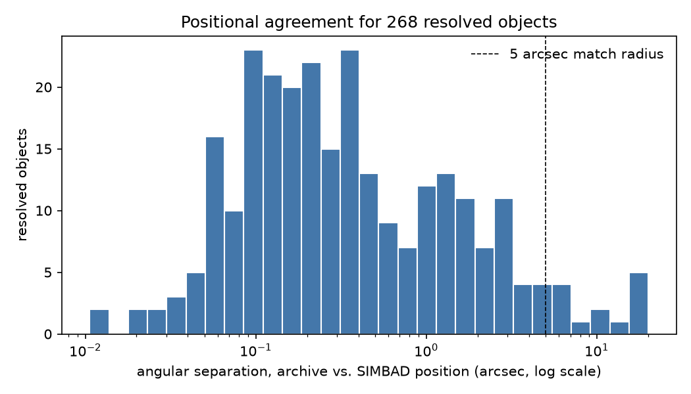

# Cross-Archive Provenance Audit

[](https://github.com/Biswajit1999/cross-archive-provenance/actions/workflows/ci.yml)
[](LICENSE)

How reliably can a real object be cross-identified and positionally
cross-matched between two independently maintained astronomical archives?

This project takes real confirmed-exoplanet host stars from the NASA
Exoplanet Archive and cross-matches each one, live, against SIMBAD --
measuring name-resolution success rate and positional agreement, and
flagging the specific objects where either fails.

## Quickstart

```bash
git clone https://github.com/Biswajit1999/cross-archive-provenance.git
cd cross-archive-provenance
python -m pip install -e ".[dev]"

pytest -q                                    # 13 tests, < 1 s
provenance run --out results/default --n 300
```

## Result




Auditing **293 real confirmed-exoplanet host stars**
(`results/default/summary.json`, generated by `provenance run`):
**91.5%** resolve in SIMBAD by exact name (268/293; this run had 0 names
where the SIMBAD query itself failed even after retries -- see "What
changed" below); of those, **95.1%** agree in position within 5 arcsec
(median separation 0.28 arcsec, max 20.1 arcsec).

Of the 25 unresolved names, 21 (84%) are microlensing-survey lens
designations (11 KMTNet, 9 OGLE, 1 MOA), consistent with those
microlensing-discovered lens stars being too faint or unconfirmed to have
a SIMBAD entry at all. An earlier version of this README said "nearly all
... are KMTNet" -- true only of a 44% subset, not checked against the
full breakdown before publishing; corrected here. The other 4 unresolved
names (`Lupus-TR-3`, `Qatar-5`, `Qatar-8`, `TIC 320419023`) are not
microlensing objects and do not fit that explanation -- plausibly an
exact-string alias mismatch (this project's exact-match-only scope,
`docs/LIMITATIONS.md`) or a genuine SIMBAD gap, not further investigated
here.

The four largest position discrepancies are **HD 285968** (20.1 arcsec),
**GJ 876** (18.1 arcsec), **GJ 674** (16.3 arcsec), and **GJ 328**
(16.2 arcsec) -- all nearby, high-proper-motion M dwarfs, consistent with
an epoch-difference explanation, not a data error (not independently
confirmed against Gaia proper motions -- `docs/LIMITATIONS.md`). An
earlier version of this README listed a different four objects (GJ 1061,
GJ 3021, GJ 328, GJ 674) that did not match the actual sorted
`position_discrepancies.csv`; corrected here. See
`results/default/unresolved_hosts.csv` and `position_discrepancies.csv`
for the specific flagged objects.

The [Gaia DR3 proper-motion validation](docs/GAIA_PROPER_MOTION_VALIDATION.md)
now tests the epoch explanation for all 13 flagged hosts using real Gaia
archive records, a predeclared 16-year propagation, a fitted implied epoch
span, candidate-ambiguity margins and Gaia-only propagated uncertainties.

## What changed in v0.2.0

`resolve_in_simbad` used to catch every exception (network error,
timeout, malformed response) and return `None` for all of them --
indistinguishable from "SIMBAD queried successfully and genuinely has no
entry for this name." A run that hit a transient network failure would
silently miscount that name as unresolved. Fixed: a failed query now
raises `SimbadQueryError`, retried up to twice before giving up; a name
that still can't be queried is written to `results/default/query_failures.csv`
and excluded from both the resolved and unresolved counts, not folded
into either. This run had 0 query failures, so the resolution-rate number
itself is unchanged from v0.1.0 -- but the two documentation errors above
(the KMTNet overclaim and the wrong top-4 list) were real and are fixed
regardless.

## What this is not

- Not a claim that either archive is "wrong" for any specific discrepant
  object -- this measures and flags disagreement, it does not adjudicate it.
- Not a fuzzy-matching or record-linkage tool; exact-string SIMBAD alias
  lookup only (see `docs/LIMITATIONS.md`).
- Not affiliated with or endorsed by the NASA Exoplanet Archive, IPAC,
  CDS, or SIMBAD.

## Repository layout

```
src/provenance/   NASA Exoplanet Archive + SIMBAD adapters, cross-match statistics, CLI
scripts/           make_figures.py, regenerates results/figures/ from committed results/
tests/             13 tests (fixture/logic-based) + 3 live-network tests
docs/              METHODS, DATA_SOURCES, LIMITATIONS, REPRODUCIBILITY, VALIDATION, CLAIMS
```

## Citation

See `CITATION.cff`.

## Contributing

See `CONTRIBUTING.md`.

## Acknowledgments

See `ACKNOWLEDGMENTS.md`.
