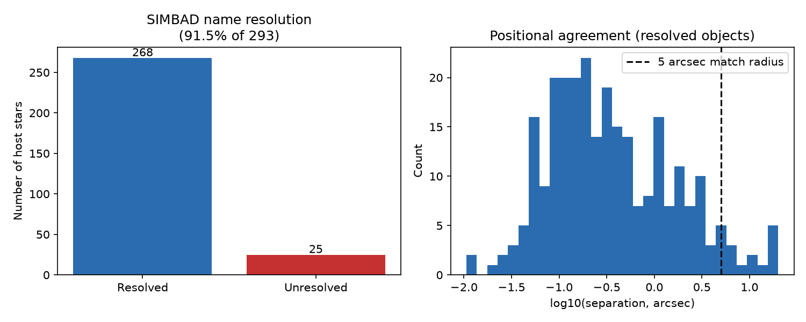

# Cross-Archive Provenance Audit

[](https://github.com/Biswajit1999/cross-archive-provenance/actions/workflows/ci.yml)
[](LICENSE)

How reliably can a real object be cross-identified and positionally
cross-matched between two independently maintained astronomical archives?

This project takes real confirmed-exoplanet host stars from the NASA
Exoplanet Archive and cross-matches each one, live, against SIMBAD --
measuring name-resolution success rate and positional agreement, and
flagging the specific objects where either fails.

## Quickstart

```bash
git clone https://github.com/Biswajit1999/cross-archive-provenance.git
cd cross-archive-provenance
python -m pip install -e ".[dev]"

pytest -q                                    # 7 tests, < 1 s
provenance run --out results/ --n 300
```

## Result



Auditing **293 real confirmed-exoplanet host stars**
(`results/default/summary.json`, generated by `provenance run`):
**91.5%** resolve in SIMBAD by exact name; of those, **95.1%** agree in
position within 5 arcsec (median separation 0.28 arcsec, max 20.1 arcsec).
Nearly all unresolved names are KMTNet microlensing lens designations,
consistent with those lens stars being too faint or unconfirmed to have a
SIMBAD entry at all. The largest position discrepancies are all nearby,
high-proper-motion M dwarfs -- consistent with an epoch-difference
explanation, not a data error. See `results/default/unresolved_hosts.csv`
and `position_discrepancies.csv` for the specific flagged objects.

## What this is not

- Not a claim that either archive is "wrong" for any specific discrepant
  object -- this measures and flags disagreement, it does not adjudicate it.
- Not a fuzzy-matching or record-linkage tool; exact-string SIMBAD alias
  lookup only (see `docs/LIMITATIONS.md`).
- Not affiliated with or endorsed by the NASA Exoplanet Archive, IPAC,
  CDS, or SIMBAD.

## Repository layout

```
src/provenance/   NASA Exoplanet Archive + SIMBAD adapters, cross-match statistics, CLI
tests/             7 tests (fixture/logic-based) + 3 live-network tests
docs/              METHODS, DATA_SOURCES, LIMITATIONS, REPRODUCIBILITY, VALIDATION, CLAIMS
```

## Citation

See `CITATION.cff`.

## Contributing

See `CONTRIBUTING.md`.

## Acknowledgments

See `ACKNOWLEDGMENTS.md`.
